# Reconstrucción 3D y detección de objetos en interiores

<p align="center">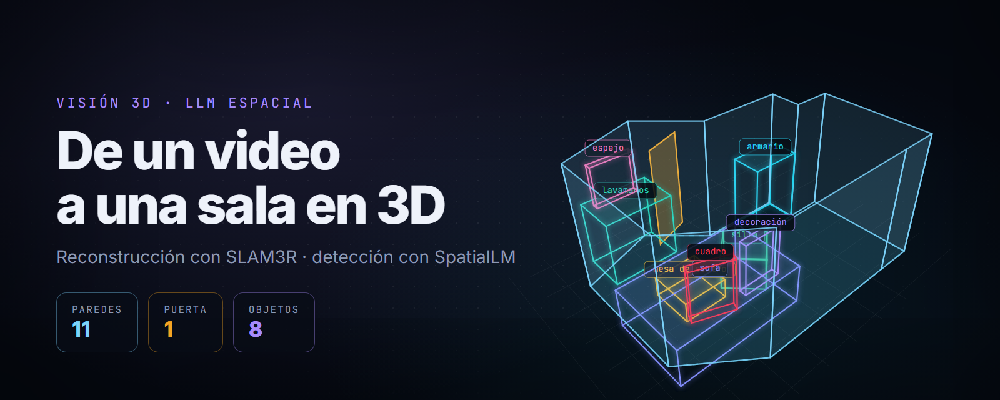</p>

<p align="center">
  
  
  
  
  
</p>

<p align="center">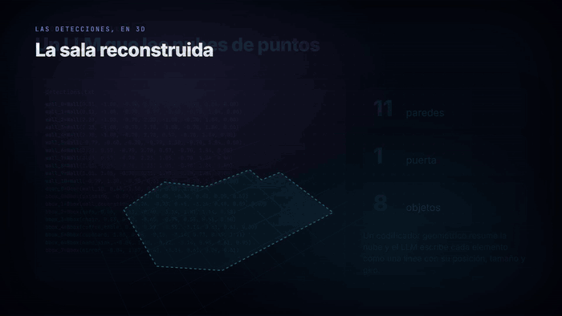</p>

<p align="center">
  <a href="docs/indoor_3d.mp4"><b>▶ Ver el video completo (61 s)</b></a> ·
  <a href="paper_3d_indoor_detection.pdf">Artículo (PDF)</a>
</p>

Basta un video grabado con el celular recorriendo una habitación. El pipeline lo convierte en una **nube de puntos 3D**,
la endereza y le pide a un **modelo de lenguaje espacial** que describa la sala: dónde están las paredes, la puerta y
cada mueble, como cajas orientadas en 3D. Al final, esas detecciones se convierten en un plano arquitectónico que se
puede recorrer.

```
video ──► SLAM3R ──► nube .ply ──► alineación PCA ──► SpatialLM ──► detections.txt ──► paredes 3D + visualización
```

La sala de la animación **no es una ilustración**: [`docs/video/exportar.py`](docs/video/exportar.py) lee la salida
real de SpatialLM sobre nuestra habitación ([`docs/resultados/detections.txt`](docs/resultados/detections.txt)) y el
video la dibuja en [Remotion](https://www.remotion.dev/) a partir de esas coordenadas.

---

## 1. Del video a la nube de puntos (SLAM3R)

<p align="center">
  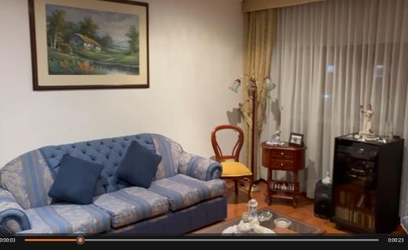
  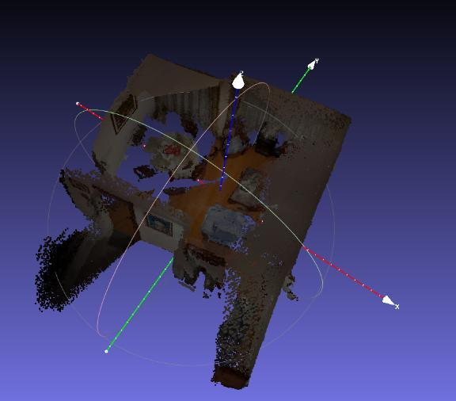
</p>

[SLAM3R](https://github.com/PKU-VCL-3DV/SLAM3R) reconstruye la escena en tiempo real a partir de los fotogramas, sin
necesidad de calibrar la cámara. [`src/recon.py`](src/recon.py) es una versión modificada de su `recon.py` que:

- guarda la nube como `.ply` con Open3D (`o3d.io.write_point_cloud`),
- desactiva la visualización interactiva y el cálculo de normales, que es costoso,
- mantiene una resolución estable y expone los parámetros principales como opciones de línea de comandos.

## 2. Enderezar la nube (alineación PCA)

<p align="center">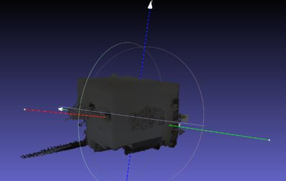</p>

SLAM3R entrega la nube en el sistema de coordenadas de la primera cámara, así que el piso suele quedar inclinado.
[`src/resize.py`](src/resize.py) la deja como la espera SpatialLM:

1. **PCA**: centra la nube y la rota con sus ejes principales, de modo que la dirección de menor varianza (la altura
   de la sala) pasa a ser Z. Se cuida que sea una rotación y no un reflejo, que dejaría la sala en espejo.
2. **Piso exacto**: PCA deja el eje vertical a unos grados del real (los muebles lo sesgan), así que se ajusta el
   plano del piso con RANSAC y se gira la nube para que su normal quede exactamente en Z.
3. **Escala y origen**: SLAM3R no entrega metros; la nube se escala a la altura de la sala (2,5 m por defecto,
   `--altura`) y el piso queda en Z = 0.

## 3. Describir la sala con un LLM espacial (SpatialLM)

<p align="center">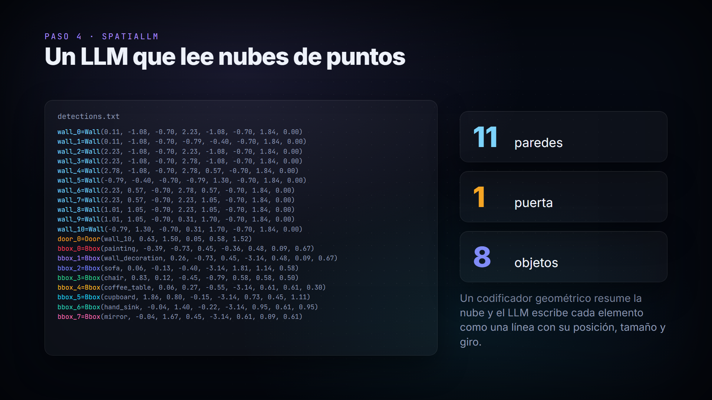</p>

[SpatialLM](https://github.com/manycore-research/SpatialLM) recibe la nube y responde con texto estructurado: una línea
por pared, puerta u objeto. En nuestra sala detectó **11 paredes** (una de longitud cero), **1 puerta** y **8 objetos**:

```
wall_0=Wall(x1, y1, z1, x2, y2, z2, alto, grosor)
door_0=Door(wall_10, x, y, z, ancho, alto)
bbox_2=Bbox(sofa, x, y, z, ángulo, ancho, fondo, alto)
```

| Objeto | Clase | | Objeto | Clase |
|---|---|---|---|---|
| cuadro | `painting` | | mesa de centro | `coffee_table` |
| decoración | `wall_decoration` | | armario | `cupboard` |
| sofá | `sofa` | | lavamanos | `hand_sink` |
| silla | `chair` | | espejo | `mirror` |

<p align="center">
  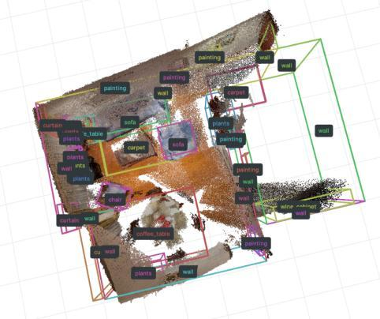
  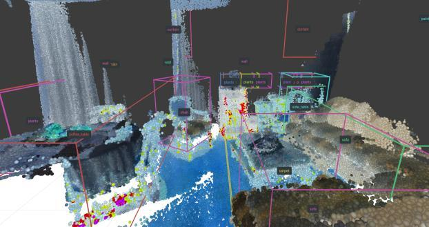
</p>

## 4. Paredes como plano arquitectónico

<p align="center">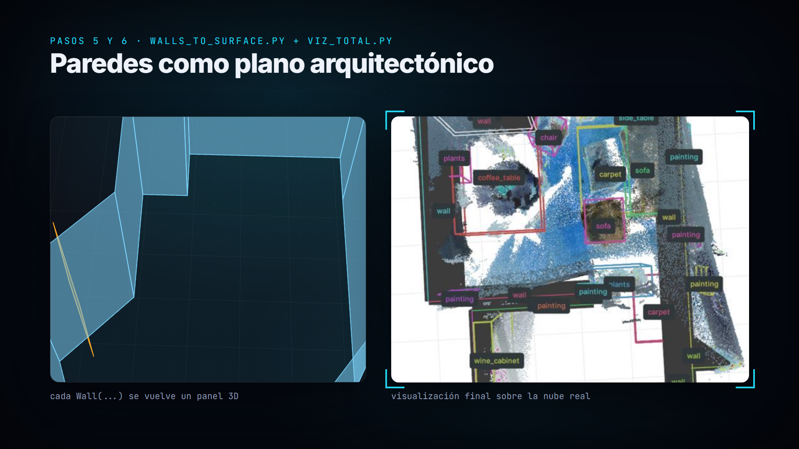</p>

[`src/walls_to_surface.py`](src/walls_to_surface.py) convierte cada `Wall(...)` en un panel 3D con grosor y cada caja
en una malla orientada; [`src/viz_total.py`](src/viz_total.py) junta la nube original, las paredes y los objetos en
una sola escena.

<p align="center">
  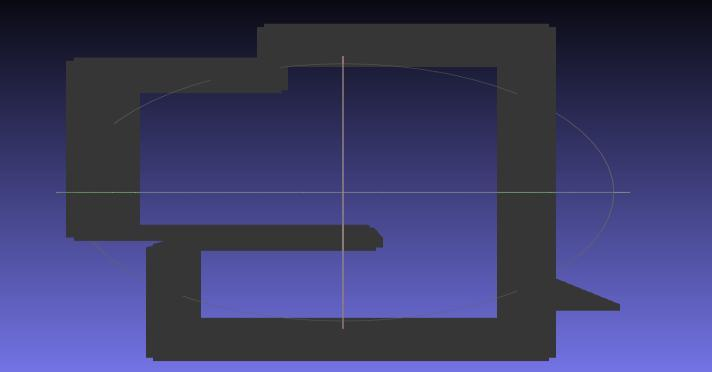
  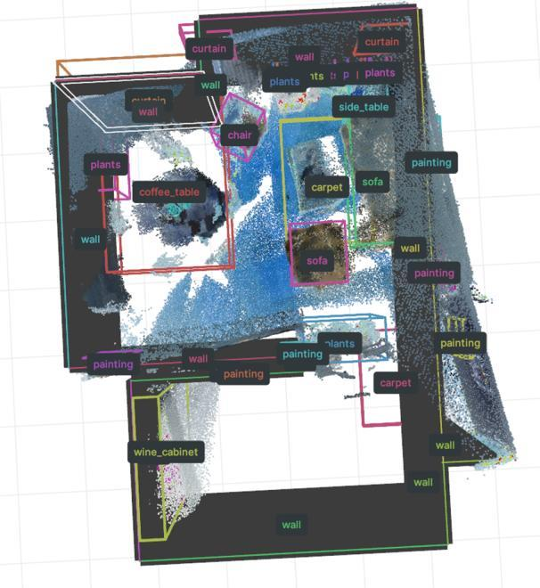
</p>

---

## Métricas de SpatialLM

<p align="center">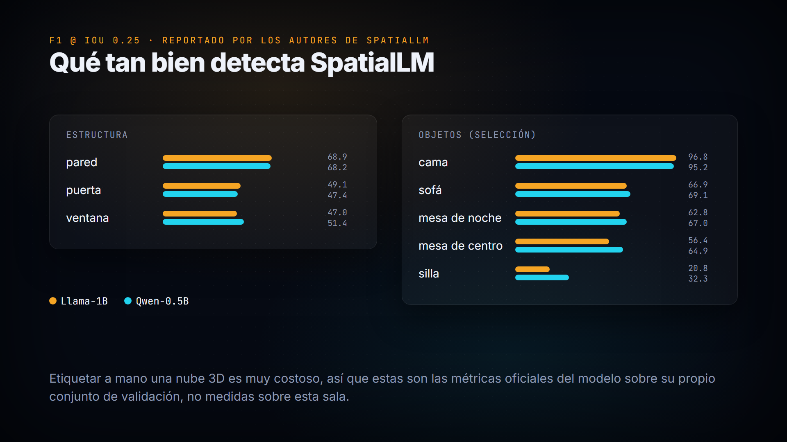</p>

> Estas cifras son las **publicadas por los autores de SpatialLM** en su benchmark, no una medición sobre nuestra
> sala (no teníamos anotaciones de referencia para ella). Sirven para saber qué tan confiable es cada clase.

**Estructura — F1 @ 0.25 IoU (2D)**

| Clase | Llama-1B | Qwen-0.5B |
|---|---|---|
| wall | 68.9 | 68.2 |
| door | 49.1 | 47.4 |
| window | 47.0 | 51.4 |

<details>
<summary><b>Objetos — F1 @ 0.25 IoU (3D)</b></summary>

| Clase | Llama-1B | Qwen-0.5B |
|---|---|---|
| bed | 96.8 | 95.2 |
| sofa | 66.9 | 69.1 |
| nightstand | 62.8 | 67.0 |
| coffee table | 56.4 | 64.9 |
| chandelier | 53.5 | 36.8 |
| dresser | 46.7 | 46.7 |
| dining table | 40.7 | 24.2 |
| carpet | 40.3 | 24.1 |
| curtain | 34.9 | 37.0 |
| painting | 34.9 | 38.2 |
| tv cabinet | 34.4 | 27.3 |
| plants | 29.5 | 26.3 |
| wardrobe | 29.4 | 39.6 |
| chair | 20.8 | 32.3 |
| stool | 17.6 | 30.8 |
| air conditioner | 16.7 | 24.0 |
| tv | 16.0 | 18.0 |
| cabinet | 15.2 | 11.2 |
| side table | 14.6 | 9.7 |
| refrigerator | 0.0 | 16.7 |

</details>

Las paredes y los muebles grandes (cama, sofá, mesa de centro) se detectan bien; los objetos pequeños o planos
(cuadros, sillas, mesas auxiliares) son los más difíciles.

---

## Cómo ejecutarlo

Requiere GPU NVIDIA con CUDA. SLAM3R y SpatialLM piden versiones de PyTorch distintas, así que cada uno va en su
propio entorno; `main.py` los ejecuta como procesos aparte con el Python de cada entorno.

```bash
# 1. Los dos modelos se clonan dentro del repositorio
git clone https://github.com/PKU-VCL-3DV/SLAM3R.git slam3r
git clone https://github.com/manycore-research/SpatialLM.git spatiallm

# 2. Un entorno por modelo, siguiendo el README de cada uno
#    (SLAM3R: conda env "slam3r", PyTorch 2.5 · SpatialLM: conda env "spatiallm", PyTorch 2.4 + poetry install)

# 3. El pipeline corre desde el entorno de SpatialLM, que ya trae open3d y rerun
conda activate spatiallm
pip install -r requirements.txt
python main.py --video sala.mp4 --slam3r_python "$(conda run -n slam3r python -c 'import sys; print(sys.executable)')"
```

`main.py` instala por su cuenta [`src/recon.py`](src/recon.py) dentro de `slam3r/`: el `recon.py` original de
SLAM3R solo acepta carpetas de imágenes y este acepta un video. El original queda guardado como `recon_original.py`.

Salida en `outputs/`:

| Archivo | Paso |
|---|---|
| `slam3r/escena/escena_online_recon.ply` | nube de SLAM3R |
| `nube_alineada.ply` | nube enderezada y escalada |
| `detections.txt` | paredes, puertas y objetos de SpatialLM |
| `paredes.ply` | paredes como malla 3D |
| `escena.rrd` | escena completa; se abre con `rerun outputs/escena.rrd` (o usa `--ver` para abrir el visor al final) |

Opciones útiles:

| Opción | Para qué |
|---|---|
| `--nube archivo.ply` | saltar SLAM3R y partir de una nube ya reconstruida |
| `--altura 2.4` | altura real de la sala, para que la escala quede en metros |
| `--invertir` | si la sala sale de cabeza (cámara sostenida al revés) |
| `--modelo manycore-research/SpatialLM1.1-Llama-1B` | otro modelo de SpatialLM |
| `--slam3r_args "--keyframe_stride 5"` | opciones extra para SLAM3R |

El video tiene que ser `.mp4`: es el único formato que el lector de SLAM3R reconoce como video. Si SLAM3R deja una
nube demasiado densa o ruidosa, su interfaz Gradio (`python slam3r/app.py`) permite ajustar la resolución y el
submuestreo; luego se sigue con `python main.py --nube <esa nube>.ply`.

Para regenerar el video y la portada:

```bash
python docs/video/exportar.py          # lee docs/resultados/detections.txt → docs/video/src/datos.json
cd docs/video
npm install
npx remotion studio                    # vista previa interactiva
npx remotion render Indoor3D ../indoor_3d.mp4
npx remotion still PortadaBanner ../portada.png
```

## Estructura

```
main.py                     orquesta el pipeline completo
src/
  recon.py                  recon.py de SLAM3R modificado (exporta .ply, sin visor)
  resize.py                 alineación PCA + piso por RANSAC + escala (Z hacia arriba)
  walls_to_surface.py       Wall(...) y Bbox(...) → mallas 3D
  viz_total.py              visualización conjunta de nube, paredes y objetos
docs/
  resultados/               figuras del artículo y salida real de SpatialLM (detections.txt)
  video/                    proyecto Remotion del video y la portada
paper_3d_indoor_detection.pdf
```

## Créditos

**Carlos Andrés Galán Pérez** — Visión computacional, Universidad del Rosario.

Este repositorio integra [SLAM3R](https://github.com/PKU-VCL-3DV/SLAM3R) y
[SpatialLM](https://github.com/manycore-research/SpatialLM); los derechos de esos modelos corresponden a sus autores.
